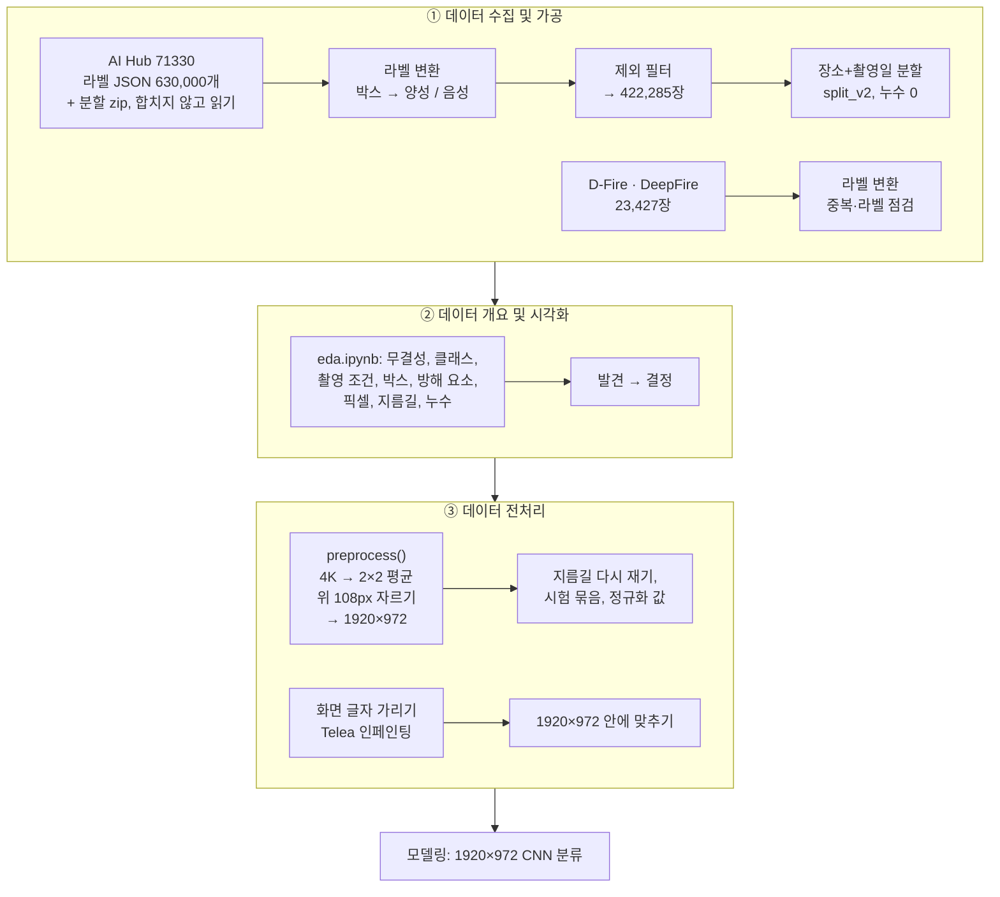
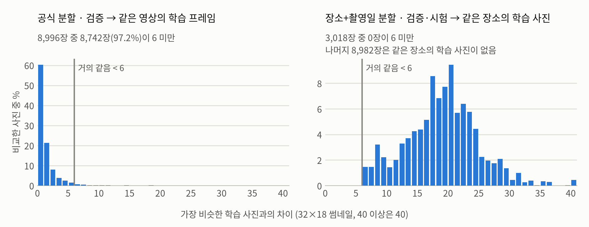
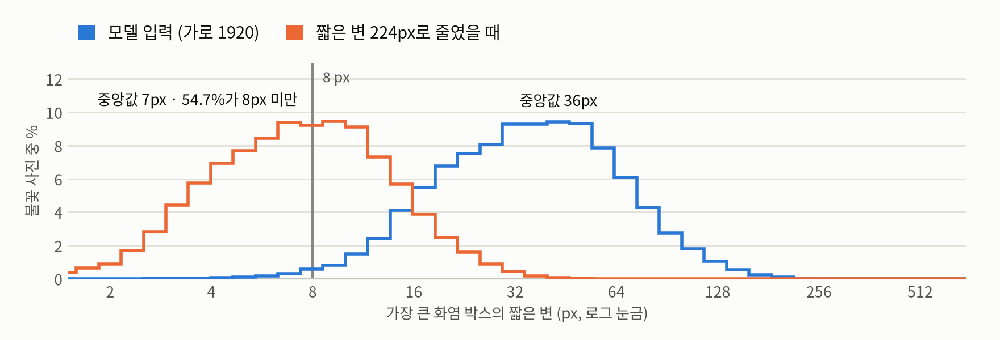
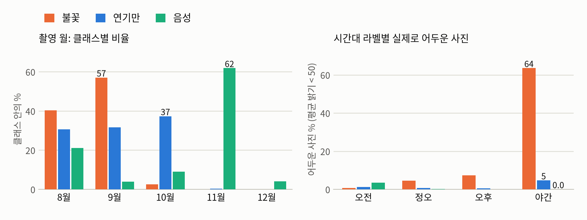
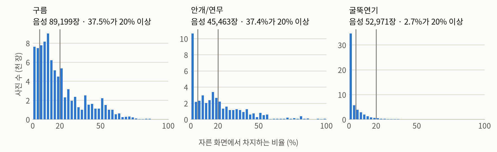
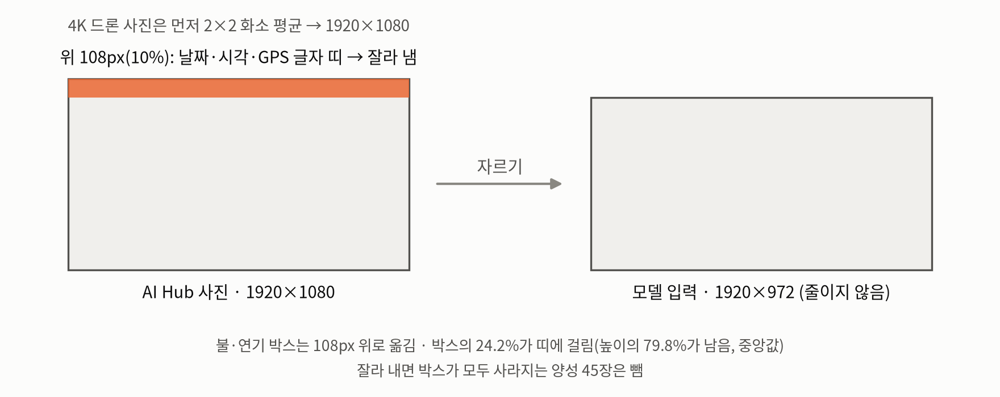
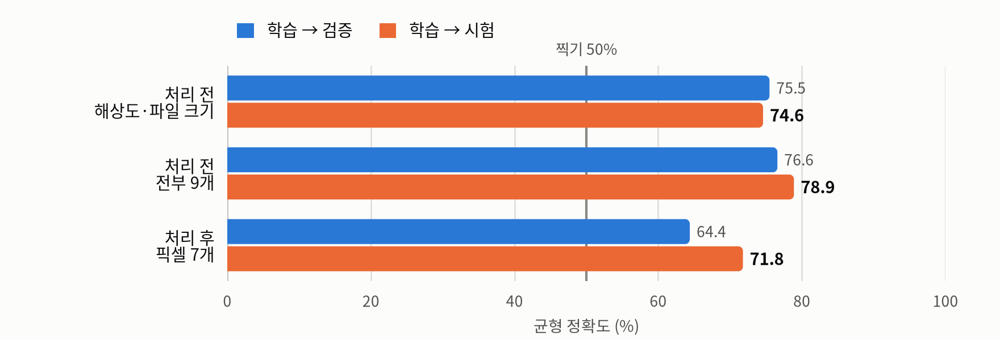
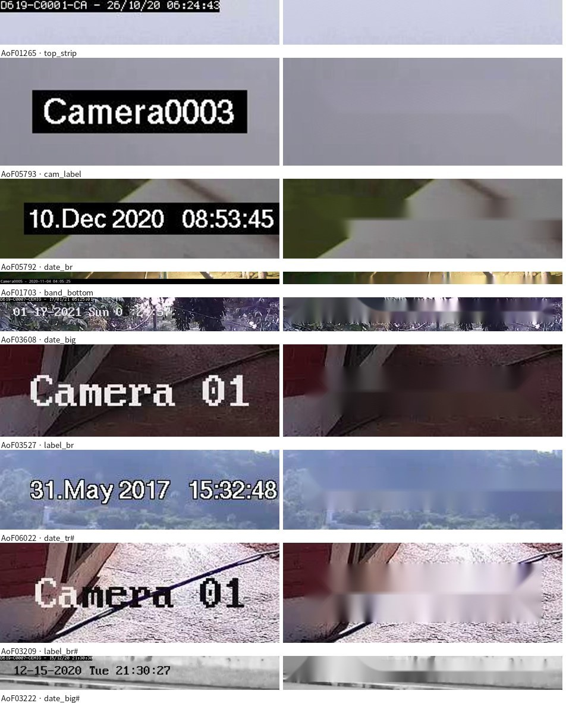

# 구름·안개가 AI 산불 감시의 오경보에 미치는 영향 분석

[English](README.md) | 한국어

카메라 사진에서 **불꽃이나 연기가 있는지 없는지**를 가리는 이진 분류 산불 탐지 프로젝트입니다. 구름·안개/연무·굴뚝 연기처럼 연기와 닮은 방해 요소가 CNN의 오경보를 늘리는지, 그리고 어떻게 줄일지를 다룹니다.
이 저장소에는 데이터 단계를 **데이터 수집 및 가공**, **데이터 개요 및 시각화**, **데이터 전처리** 세 부분으로 담았습니다. 대상은 AI Hub 산불 데이터(71330)와, 다른 출처 시험 세트로 쓸 D-Fire·DeepFire입니다. 모델링은 다음 단계입니다.

- **가설**: 화면에서 구름·안개/연무가 차지하는 면적이 클수록 오경보가 늘어난다.
- **목표**: F1 ≥ 0.85, 구름+안개 면적 ≥ 20% 음성의 오경보율을 기준선의 절반 이하로, Recall 하락은 1%p 이내.
- **배경**: 2025년 국내 AI 산불 감시 플랫폼 경보 약 20만 건 가운데 약 13만 8천 건(약 70%)이 오류였고, 오류 유형으로 빛 번짐·렌즈 이물질·안개·구름·흔들리는 나무가 꼽혔습니다(산림청 자료, 2026년 9월 보도).

## 데이터 단계 결과

| | |
| --- | --- |
| 쓰는 AI Hub 사진 | 라벨 630,000장 중 **422,285장**: 학습 257,183 · 검증 75,118 · 시험 89,984 |
| 클래스 | 양성(불꽃 또는 연기) 266,338 = 불꽃 86,702 + 연기만 179,636 · 음성 155,947 |
| 분할 | **장소+촬영일** 묶음 82개 단위, 60 : 20 : 20. 공식 분할은 검증 사진의 97.2%가 학습에 거의 같은 사진을 갖는 누수가 있었고, 새 분할은 검증·시험 12,000장을 확인한 결과 0장 |
| 모델 입력 | **1920×972**: 4K 사진은 2×2 화소 평균으로 1920×1080, 그다음 위 108px(화면의 날짜·시각·GPS 글자)를 잘라 냄. 줄이지 않음 — 가장 큰 화염 박스의 짧은 변이 중앙값 36px인데, 224px로 줄이면 7px |
| 지름길 점검 | 간단한 사진 통계만 쓰는 깊이 2 결정 나무의 시험 균형 정확도: 전처리 전 78.9% → 후 71.8% (찍기 50%) |
| 다른 출처 시험 세트 | D-Fire 21,498장(양성 11,689 · 음성 9,809), DeepFire 1,896장(948 · 948). 화면 글자를 주변 화소로 메우고 1920×972 안에 맞춤 |
| 처리 오류 | AI Hub 422,285장, 다른 출처 23,423장 모두 0장 |

## 처리 흐름



## 1. 데이터 수집 및 가공

단계마다 [`notebooks/preprocess.ipynb`](notebooks/preprocess.ipynb)(AI Hub)와 [`notebooks/external.ipynb`](notebooks/external.ipynb)(D-Fire·DeepFire)의 한 절이며, 코드와 출력이 함께 있습니다. 라벨·분할·누수 점검은 저장소 맨 위의 스크립트입니다.

### 1.1 데이터와 역할

| 데이터 | 내용 | 역할 |
| --- | --- | --- |
| AI Hub 71330 (지역안전재난(산불) 방재의 고도화를 위한 대규모 인공지능 데이터베이스) | 라벨 630,000장(공식 학습 560,365 · 검증 69,635), 대부분 1920×1080, 일부 3840×2160. 실제 양성: 강릉 16곳의 모의 발화(작은 모닥불·연막탄). 음성: 전국 54곳 풍경, 구름·안개/연무·굴뚝연기 박스가 있음. 합성 양성 126,107장 | 학습·검증·시험 |
| [D-Fire](https://github.com/gaiasd/DFireDataset) (CC0) | 연기·불 박스가 있는 21,527장: 감시 카메라(AoF), 인터넷 사진, 공개 데이터 | 다른 출처 시험 |
| DeepFire (Mendeley Data, CC BY 4.0) | 숲 사진 1,900장, 250×250, 불 / 불 없음 | 다른 출처 시험 |
| SmokeFire (Hugging Face) | 7,575장, 먼저 점검했지만 **쓰지 않음**: 연기 클래스가 CCTV 장면 몇 개의 프레임이고, 해상도만으로 시험 86.8%를 맞히며, 검증·시험의 54%가 학습 사진과 거의 같음 | — |

학습은 AI Hub로만 합니다. 데이터 출처로 클래스를 가르는 지름길을 막기 위해서이고, D-Fire·DeepFire로는 다른 곳의 사진에서도 통하는지 봅니다.

### 1.2 원천 압축 파일 읽기

AI Hub 학습 사진은 분할 ZIP64(`TS.z01`~`TS.z05` + `TS.zip`, 588GB)로 배포되는데, 파이썬 `zipfile`은 이를 열지 못하고 합치려면 588GB가 더 필요합니다. [`aihub_split_zip.py`](aihub_split_zip.py)는 마지막 볼륨의 중앙 디렉터리를 직접 읽어 파일마다 볼륨과 위치를 계산하므로, 조각 파일에서 바로 사진을 꺼냅니다. 사진은 읽을 때마다 압축 파일에서 처리하며, 처리한 사본을 따로 저장하지 않습니다.

### 1.3 라벨 변환: 물체 박스 → 사진 한 장에 라벨 하나

AI Hub 라벨은 사진이 아니라 물체 단위입니다(박스 종류: 화염, 흑색연기, 백색/회색연기, 구름, 안개/연무, 굴뚝연기). 사진 라벨은 DB 이름과 박스로 규칙에 따라 정했습니다([`analyze_aihub_labels.py`](analyze_aihub_labels.py), [`summarize_aihub_labels.py`](summarize_aihub_labels.py)).

| 결과 | 규칙 | 사진 |
| --- | --- | ---: |
| **양성** | `PositiveRealDB`이고 화염·연기 박스가 하나라도 있음 (화염이 있으면 *불꽃*, 연기만 있으면 *연기*) | 266,383 |
| **음성** | `NegativeDB`이고 화염·연기 박스가 없음 (구름·안개/연무·굴뚝연기 박스만) | 156,260 |
| 따로 보관: 음성 속 연기 | `NegativeDB`인데 백색/회색연기 박스가 있음. 공장 연기도 있지만 숲·마을의 진짜 같은 연기도 있어 어느 쪽으로도 쓰지 않음 | 23,729 |
| 제외: 합성 양성 | `PositiveSyntheticDB`: CCTV·드론 화면에 불꽃·연기를 붙여 넣은 사진 | 126,107 |
| 제외: 안 쓰는 양성 장소 | 실제 양성 16곳 중 12곳. 사진이 가장 많은 4곳(실제 양성 사진의 82.2%)만 씀 | 57,521 |

### 1.4 제외 필터

| 단계 | 빼는 사진 | 남는 사진 |
| --- | ---: | ---: |
| 라벨 JSON 전체 | | 630,000 |
| 합성 양성 | −126,107 | 503,893 |
| 안 쓰는 양성 장소 12곳 | −57,521 | 446,372 |
| 음성 속 연기 → '판별 불확실'로 따로 보관 | −23,729 | 422,643 |
| 지원하지 않는 해상도 (1280×720 · 960×540 · 4032×1816) | −290 | 422,353 |
| 위 띠를 자르면 불·연기 박스가 모두 없어지는 양성 | −45 | 422,308 |
| 시각 글자가 자르는 선 아래에 걸리는 CCTV 1대 (평창) | −23 | **422,285** |

### 1.5 장소+촬영일 단위 분할

공식 분할은 같은 영상의 이웃 프레임이 학습과 검증에 나뉘어 들어 있습니다(2.1절). 그래서 **같은 장소·같은 촬영일** 사진을 한 묶음으로 두고, 한 카메라가 이틀에 걸치거나 같은 장소의 두 날짜에 거의 같은 사진이 있으면([`aihub_group_links.py`](aihub_group_links.py): 같은 영상이 다른 날짜로 다시 들어간 경우) 묶음을 합쳐 82개 묶음을 만들었습니다. 묶음 단위로 학습·검증·시험에 60 : 20 : 20으로 나눕니다.

- `split_v1`([`make_aihub_split.py`](make_aihub_split.py))은 클래스·낮밤·날씨·강릉 여부는 맞췄지만 기기와 방해 요소를 보지 않아, 시험 음성의 63%가 드론 사진(학습은 10%)이 됐습니다. 이대로면 시험 오경보율에 안개 효과와 '낯선 시점' 효과가 섞입니다.
- `split_v2`([`make_aihub_split_v2.py`](make_aihub_split_v2.py))는 양성 묶음 13개는 그대로 두고 음성만 든 묶음 69개를 다시 배정했습니다(32개 이동). 드론, 구름·안개 **면적**(≥5%, ≥20%), 굴뚝연기, 8~9월 사진의 비율도 맞춥니다. v1 배정과 무작위 배정 240개에서 시작해 묶음 옮기기·맞바꾸기를 비용이 더 줄지 않을 때까지 반복했습니다. 앞선 두 시도는 버렸습니다: 묶음을 가장 적게 옮기는 방법은 드론은 맞췄지만 시험의 구름 음성이 24%에서 13%로 줄었고, 안개를 '박스가 있음'으로 세면 안개가 조금 걸친 큰 묶음 하나(면적 중앙값 0.3%)가 시험 몫을 채워 진짜 안개 장면이 모두 검증으로 빠졌습니다.

| 층 (음성) | 학습 / 검증 / 시험, v1 | 학습 / 검증 / 시험, v2 |
| --- | --- | --- |
| 드론 | 29.7 / 6.6 / 63.8% | 59.6 / 20.1 / 20.3% |
| 안개/연무 면적 ≥ 20% | 86.3 / 0.0 / 13.7% | 61.6 / 17.6 / 20.7% |
| 구름 면적 ≥ 20% | 35.8 / 28.1 / 36.2% | 58.3 / 20.0 / 21.7% |

검증·시험의 층 비율이 20%에서 가장 멀리 벗어난 정도는 43.8%p에서 4.7%p로 줄었고, [`check_aihub_split.py`](check_aihub_split.py)로 확인하면 같은 장소의 학습 사진과 거의 같은 검증·시험 사진은 없습니다.

| | 학습 | 검증 | 시험 | 전체 |
| --- | ---: | ---: | ---: | ---: |
| 양성 · 불꽃 | 49,406 | 8,560 | 28,736 | 86,702 |
| 양성 · 연기만 | 110,195 | 37,550 | 31,891 | 179,636 |
| 음성 | 97,582 | 29,008 | 29,357 | 155,947 |
| **전체** | **257,183** | **75,118** | **89,984** | **422,285** |

양성 장소는 학습 2곳, 검증 4곳, 시험 3곳이라, 시험 불꽃 사진은 대부분 학습에 없던 장소에서 나옵니다.

### 1.6 라벨 정리

박스를 처리한 사진 좌표로 옮기고(`x' = x·1920/W`, `y' = y·1920/W − 108`), 방해 요소 면적을 자른 화면에서 다시 쟀으며, 날씨·시간대·기기·거리 같은 조건 열을 정리했습니다. 촬영 날짜는 형식이 섞여 있어 `YYYYMMDD`로 통일했습니다.

### 1.7 D-Fire·DeepFire

- **D-Fire**: 21,527장(감시 카메라 8,384, 인터넷 11,807, 공개 데이터 1,336). YOLO 박스(0 = 연기, 1 = 불)를 AI Hub와 같은 사진 라벨로 바꿉니다. 크기가 0인 박스 18개는 박스 통계에서 뺍니다.
- **DeepFire**: 불 / 불 없음 폴더의 1,900장. 완전히 같은 사진 4장을 뺍니다. 76.6%가 SmokeFire나 Kaggle 데이터와 같은 사진이라 SmokeFire와 독립된 데이터가 아니고, 시험에만 씁니다.
- **라벨 점검**: 거의 같은 사진을 묶어(D-Fire 10,661묶음) 장면 단위로 결과를 셀 수 있게 하고, 불·연기가 보이는 음성 7장은 빼고, 판별이 어려운 연무 하늘 22장은 따로 둡니다.

## 2. 데이터 개요 및 시각화

[`notebooks/eda.ipynb`](notebooks/eda.ipynb)는 실험에 쓰는 모든 라벨과 사진을 13개 절로 살펴봅니다: 라벨·촬영 정보 무결성, 분할별 클래스 구성, 해상도·파일 크기, 촬영 조건(날씨·시간대·기기·거리), 장소·날짜, 박스 크기·위치, 방해 요소, 픽셀 통계(영상마다 10장 중 1장), 지름길 점검, 중복·누수. 노트북의 차트와 표는 그대로 두고 AI Hub 사진만 지웠습니다. 아래 그림 4개는 최종 422,285장으로 그렸고([`figures/make_figure_data.py`](figures/make_figure_data.py)가 그 바탕 숫자를 [`figures/data/`](figures/data/)에 씀), 분할과 전처리를 정하게 한 발견을 보여 줍니다.

### 2.1 공식 분할은 누수가 있다

<picture>
  <source media="(prefers-color-scheme: dark)" srcset="figures/leak_ko_dark.png">
  
</picture>

검증 사진마다 32×18 썸네일로 가장 비슷한 학습 사진과 비교했습니다. 공식 분할에서는 검증 8,996장 중 8,742장(97.2%)이 같은 영상의 학습 프레임과 거의 같습니다(차이 6 미만). 장소+촬영일 분할에서는 확인한 검증·시험 12,000장 중 같은 장소의 학습 사진이 있는 것이 3,018장뿐이고, 그중 그만큼 가까운 사진은 없습니다. → 장소+촬영일로 나눔(1.5절).

### 2.2 불꽃이 아주 작다

<picture>
  <source media="(prefers-color-scheme: dark)" srcset="figures/flame_ko_dark.png">
  
</picture>

모델 입력에서 불꽃 사진의 가장 큰 화염 박스는 짧은 변이 중앙값 36px입니다(8px 미만 1.0%). 사진의 짧은 변을 ImageNet 기본 입력인 224px로 줄이면 7px가 되고, 불꽃 사진의 54.7%에서 불꽃이 8px 미만이 됩니다. → 1920×972 전체 화면을 그대로 입력(3.1절).

### 2.3 계절과 밤이 클래스를 따라간다

<picture>
  <source media="(prefers-color-scheme: dark)" srcset="figures/time_ko_dark.png">
  
</picture>

모의 발화는 8~9월에 찍었고(불꽃 사진의 97%), 음성은 대부분 10~12월에 찍었습니다(75%). 그래서 색과 빛이 클래스에 따라 달라집니다. '야간' 라벨 사진은 불꽃이면 64%가 실제로 어둡지만 음성은 0.04%뿐입니다. 밤 음성이 없어서, 어두운 사진의 92.5%가 양성입니다. → 어두운 사진과 8~9월 음성은 시험 묶음을 따로 두고, 간단한 규칙이 이 차이를 얼마나 쓸 수 있는지는 지름길 점검(3.2절)으로 잽니다.

### 2.4 음성 사진의 방해 요소

<picture>
  <source media="(prefers-color-scheme: dark)" srcset="figures/distractors_ko_dark.png">
  
</picture>

음성 사진에는 구름·안개/연무·굴뚝연기 박스가 있어서 가설을 잴 수 있습니다. 구름이 있는 음성 89,199장 중 37.5%, 안개/연무가 있는 45,463장 중 37.4%, 굴뚝연기가 있는 52,971장 중 2.7%에서 자른 화면의 20% 이상을 차지합니다. 5%와 20% 선은 시험 세트의 면적 구간입니다(3.3절).

### 2.5 발견과 결정

| 발견 | 결정 |
| --- | --- |
| 공식 분할: 검증 사진의 97.2%가 같은 영상의 학습 프레임과 거의 같음 | 장소+촬영일 분할(split_v2) |
| '야간' 음성은 어둡지 않음(0.04%), 어두운 사진의 92.5%가 양성 | 밤 정상을 만들지 않고, 어두운 사진 결과를 따로 냄(`dark` 열) |
| 불꽃이 아주 작음: 모델 입력 36px, 224px로 줄이면 7px(54.7%가 8px 미만) | 줄이지 않고 1920×972 입력 |
| 4K 사진 비율이 고르지 않음(시험 정상 19%, 시험 불꽃 6%) | 4K는 2×2 평균으로 1920×1080에 맞춰 해상도로 클래스를 맞히지 못하게 함 |
| 계절이 클래스와 묶임: 불꽃 97%·연기 62%가 8~9월, 정상 75%가 10~12월 | 8~9월 정상 사진의 오경보율을 따로 보고, 모델링에서 색상 증강 검토 |
| 음성 속 연기 박스(23,729장) | '판별 불확실'로 따로 보관 |
| 한 장소의 GPS 값이 45개 주소에 복사돼 있음(122,343장) | GPS·고도는 쓰지 않음 |

## 3. 데이터 전처리

### 3.1 AI Hub 사진: 학습·검증·시험에 같은 함수 하나

<picture>
  <source media="(prefers-color-scheme: dark)" srcset="figures/frame_ko_dark.png">
  
</picture>

```python
# wildfire_data.py (발췌)
BASE_W, BASE_H = 1920, 1080     # 해상도 통일 기준
CROP_TOP = 108                  # 위 10%: 날짜·시각·GPS 글자 띠 (평창 CCTV 1대를 빼면 모든 카메라의 글자가 이 안에 있음)
OUT_W, OUT_H = BASE_W, BASE_H - CROP_TOP   # 1920×972

def preprocess(jpeg_bytes):
    """원천 JPEG 바이트 → 1920×972 RGB PIL 사진. 1920×1080·3840×2160만 받는다(나머지 해상도는 목록에서 뺐다)."""
    im = Image.open(io.BytesIO(jpeg_bytes)).convert('RGB')
    if im.size == (2 * BASE_W, 2 * BASE_H):
        im = im.reduce(2)                     # 2×2 화소 평균 (정확히 절반)
    elif im.size != (BASE_W, BASE_H):
        raise ValueError(f'지원하지 않는 해상도 {im.size}')
    return im.crop((0, CROP_TOP, OUT_W, BASE_H))
```

- **위 띠를 자르는 이유:** 드론 사진 왼쪽 위에 날짜·GPS 글자가 있고(1080 드론 사진 중 양성 64.6%, 음성 34.3%), CCTV 사진에는 시각 글자가 있습니다. 카메라 392대를 한 장씩 확인했고, 한 대를 빼면 모든 글자가 위 108px 안에 있습니다.
- **비용:** 1080 사진 한 장을 압축 파일에서 읽는 데 5.6ms, 처리에 15.9ms(4K는 16.6 + 60.9ms). 422,285장 전체가 CPU 3.6시간, 오류 0장.
- **정규화 값:** 학습 세트 평균 (0.384, 0.385, 0.345), 표준편차 (0.256, 0.252, 0.265)를 ImageNet 값과 함께 [`prep/norm_stats.json`](prep/norm_stats.json)에 저장했습니다.

### 3.2 지름길 다시 재기

모델은 불·연기 대신 해상도·파일 크기·밝기를 보고도 점수를 낼 수 있습니다. 학습 사진으로 깊이 2 결정 나무를 만들고 검증·시험에서 재면, 이런 숫자만으로 얼마나 맞히는지 알 수 있습니다.

<picture>
  <source media="(prefers-color-scheme: dark)" srcset="figures/shortcut_ko_dark.png">
  
</picture>

전처리로 해상도와 파일 크기라는 단서는 사라집니다. 남은 71.8%는 어두움·선명도·불꽃색 화소 비율에서 나오며([`prep/tables/shortcut_rule.txt`](prep/tables/shortcut_rule.txt)), 2.3절의 밤·계절 쏠림을 따릅니다. 학습한 모델은 이 기준선을 옳은 이유로 넘어야 합니다. 4K 출신 사진을 1080 사진의 선명도에 맞춰 흐리게 하는 방법은 효과가 없어(72.0 → 72.2%) 넣지 않았습니다.

### 3.3 가설 검증용 시험 묶음

[`prep/test_groups.csv`](prep/test_groups.csv)에 시험 묶음을 목록에 대한 pandas 조건식으로 적어, 오경보율을 방해 요소 종류·면적·장소별로 낼 수 있게 했습니다.

| 시험 음성 | 사진 | 장소 |
| --- | ---: | ---: |
| 전체 | 29,357 | 19 |
| 구름만 | 11,585 | 17 |
| 안개/연무만 | 4,708 | 6 |
| 굴뚝연기만 | 9,058 | 3 |
| 구름+안개 면적 < 5% / 5~20% / ≥ 20% | 11,355 / 7,663 / 10,339 | 13 / 16 / 15 |
| 안개/연무 면적 ≥ 20% | 3,524 | 6 |
| 드론 | 6,633 | 5 |
| 8~9월 (양성과 같은 계절) | 7,407 | 7 |

### 3.4 D-Fire·DeepFire: 화면 글자와 크기

[`external_data.py`](external_data.py)가 바깥 사진을 AI Hub와 같은 입력으로 만듭니다.

1. **화면 글자:** D-Fire 감시 카메라 사진 8,384장 대부분에 날짜·시각·카메라 이름이 찍혀 있습니다. `find_overlays()`가 글자 줄(위 띠, 카메라 이름, 오른쪽 아래 날짜, 아래 띠, 큰 날짜, 좌우 뒤집힌 사진은 뒤집어 다시)을 찾고, 자동 검출이 놓쳤을 만한 사진은 모두 눈으로 확인해 63장의 65자리를 직접 적었습니다. 그 자리는 3px 넓혀 주변 화소로 메웁니다(OpenCV Telea 인페인팅). 평평한 회색 상자로 덮으면 그것 자체가 연기·안개처럼 보이기 때문입니다. 8,201장(97.8%)을 가렸습니다.
2. **크기:** 비율을 지켜 1920×972 안에 넣고, 남는 곳은 정규화하면 0이 되는 ImageNet 평균색으로 채웁니다. 위를 자르지 않습니다. 그 처리는 AI Hub 글자 띠 때문이었고, 여기서는 위로 올라가는 연기만 잘립니다.



결과: D-Fire 21,498장(양성 11,689 · 음성 9,809, 어두운 음성 896 · 어두운 양성 2,499), DeepFire 1,896장(각 948), 모두 1920×972입니다. 밤 음성, 노을, 도시 불빛, 번개, 공장 연기 같은 시험 묶음도 따로 만들었습니다([`prep/external_test_groups.csv`](prep/external_test_groups.csv)).

## 4. 다음 단계: 모델링

학습 때의 처리는 [`modeling/`](modeling/)에 초안만 있고 아직 돌리지 않았습니다. 에폭마다 영상·클래스당 최대 N장을 뽑는 샘플러(영상당 사진 중앙값 23~72장, 가장 긴 영상 1,012장), 뽑힌 수로 정하는 클래스 가중치, 좌우 뒤집기와 작은 이동 증강이며, 모두 `preprocess()` 위에서 돕니다. 계획한 실험은 E1 기준선(직접 설계한 작은 CNN, ResNet-18/50, EfficientNet-B0 / MobileNetV3, 1920×972 입력), E2 하이퍼파라미터 튜닝, E3 방해 요소 묶음의 오경보 줄이기이고, 위 목표와 지름길 기준선 71.8%에 견줘 평가합니다.

## 저장소 구조

```text
Wildfire-detection/
├── aihub_split_zip.py            # ① AI Hub 분할 ZIP64(TS.z01~z05 + TS.zip)를 합치지 않고 읽기
├── analyze_aihub_labels.py       # ① 라벨 JSON 전부 → 사진 한 장에 한 줄
├── summarize_aihub_labels.py     # ① 클래스 변환, 출처·조건별 쏠림
├── aihub_group_links.py          # ① 같은 장소 다른 날짜의 거의 같은 사진 → 묶음 합치기
├── make_aihub_split.py           # ① split_v1: 장소+촬영일
├── make_aihub_split_v2.py        # ① split_v2: 음성 묶음 재배정(드론·구름·안개·굴뚝·계절)
├── check_aihub_split.py          # ① 새 분할 누수 점검
├── analyze_smokefire.py, analyze_deepfire.py   # ① 후보 데이터 점검
├── check_aihub_leak.py           # ② 공식 분할 누수
├── analyze_aihub_images.py       # ② 사진마다 밝기·대비·채도·선명도·글자 점수·썸네일
├── summarize_aihub_images.py     # ② 밤 정상, 화면 글자, 얕은 나무 지름길, 근접 중복
├── check_night_normal.py, check_fire_lookalike.py, tag_lookalike_clip.py   # ② 어두운 음성, 불처럼 보이는 음성(SigLIP 태그)
├── aihub_look_val.py, aihub_sample_sheets.py   # ② 로컬 확인용 사진 격자(그림은 Git에 없음)
├── wildfire_data.py              # ③ AI Hub: preprocess(), 박스 좌표 변환, 학습용 압축 파일 읽기
├── external_data.py              # ③ D-Fire / DeepFire: find_overlays(), 직접 지정한 글자 자리, 인페인팅, 1920×972 맞추기
├── notebooks/
│   ├── preprocess.ipynb          #   ①③ AI Hub 가공·전처리 (출력 포함, AI Hub 사진만 뺌)
│   ├── eda.ipynb                 #   ②  AI Hub 개요 및 시각화 (출력 포함, AI Hub 사진만 뺌)
│   ├── external.ipynb            #   ①③ D-Fire / DeepFire 가공·전처리 (사진 포함)
│   ├── eda_lib.py, prep_lib.py, external_lib.py   # 무거운 계산, 결과는 notebooks/cache/에
│   └── build_eda.py, build_preprocess.py, build_external.py, eda_obs.json, export_eda.py   # 노트북 만들기·실행
├── prep/                         # 노트북 산출물: tables/, norm_stats.json, 시험 묶음, D-Fire / DeepFire 목록
├── report/                       # 라벨·누수·분할 점검의 요약과 로그
├── figures/                      # README 그림: make_figure_data.py → data/(개수만) → make_figures.py
└── modeling/                     # 학습 때의 처리 (초안)
```

① 데이터 수집 및 가공 · ② 데이터 개요 및 시각화 · ③ 데이터 전처리

## 실행 방법

NVIDIA DGX Spark(aarch64), Python 3.13에서 확인했습니다. 스크립트는 자기 옆의 폴더(`data/`, `prep/`, `report/`, `notebooks/cache/`)를 쓰므로 저장소 폴더가 곧 프로젝트 폴더입니다. AI Hub 71330은 `/data/aihub/71330/`에서 읽습니다(`wildfire_data.py`·`notebooks/eda_lib.py`의 `AIHUB`, 점검 스크립트의 `BASE`).

```bash
python3 -m venv .venv_eda && .venv_eda/bin/pip install -r requirements.txt
.venv_eda/bin/python -m ipykernel install --user --name eda      # 노트북 커널 이름 "eda"
```

1. [AI Hub](https://aihub.or.kr)에서 71330 승인을 받아 라벨 `TL.zip`·`VL.zip`, 사진 `TS.z01`~`TS.zip`·`VS.zip`을 받고, D-Fire·DeepFire는 `data/DFire`, `data/DeepFire`에 받습니다.
2. 라벨과 점검: `analyze_aihub_labels.py` → `summarize_aihub_labels.py` → `analyze_aihub_images.py val|train` → `check_aihub_leak.py`
3. 분할: `aihub_group_links.py` → `make_aihub_split.py` → `make_aihub_split_v2.py` → `check_aihub_split.py 2000 v2`
4. 노트북: `cd notebooks && ../.venv_eda/bin/python build_preprocess.py`(그리고 `build_eda.py`, `build_external.py`)가 노트북을 다시 만들고 실행합니다. AI Hub 사진 전체를 처음 처리할 때 약 33분, 그 뒤에는 `notebooks/cache/`로 약 40초 걸립니다.
5. 그림: `python figures/make_figure_data.py && python figures/make_figures.py`

## 포함하지 않은 것

- **AI Hub 데이터:** 사진, 라벨, 그리고 사진 한 장씩 적은 목록(manifest, 박스, 분할 파일, 사진별 측정값). AI Hub 이용 약관상 재배포할 수 없어서, 노트북은 표와 차트는 두고 AI Hub 사진만 지웠고, `figures/data/`에는 개수만 있습니다. 위 단계를 실행하면 목록이 다시 만들어집니다.
- **프로젝트 문서**(제안서, 발표 자료, 보고서): AI Hub 사진이 들어 있습니다.
- D-Fire·DeepFire 사진 자체(원래 출처에서 받기). 가공한 목록은 넣었습니다(`prep/external_manifest.csv.gz`, `prep/external_boxes.csv.gz`).

## 참고

- AI Hub, 지역안전재난(산불) 방재의 고도화를 위한 대규모 인공지능 데이터베이스 (데이터 71330).
- D-Fire: P. V. A. B. de Venâncio, A. C. Lisboa, A. V. Barbosa, "An automatic fire detection system based on deep convolutional neural networks for low-power, resource-constrained devices", *Neural Computing and Applications*, 2022. [github.com/gaiasd/DFireDataset](https://github.com/gaiasd/DFireDataset) (CC0).
- DeepFire: A. Khan, B. Hassan, Mendeley Data, 2020, [doi:10.17632/gjmr63rz2r.1](https://doi.org/10.17632/gjmr63rz2r.1) (CC BY 4.0).
- A. Telea, "An image inpainting technique based on the fast marching method", *Journal of Graphics Tools*, 2004 (OpenCV `INPAINT_TELEA`).
