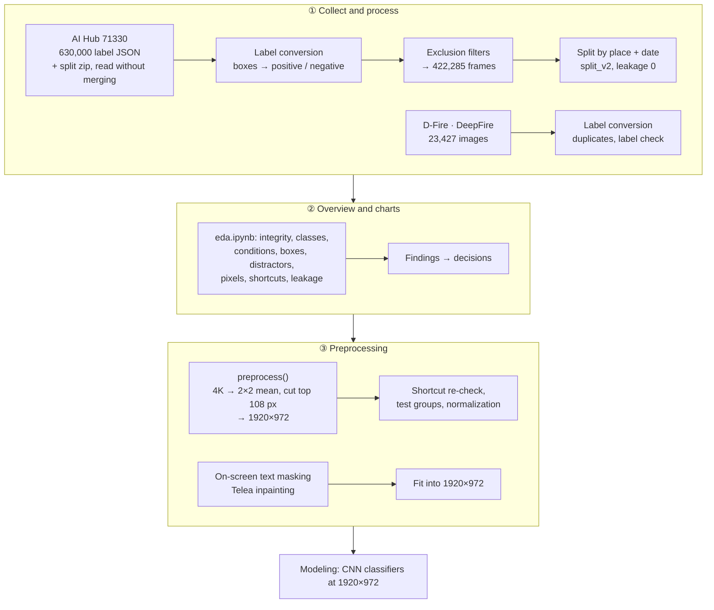
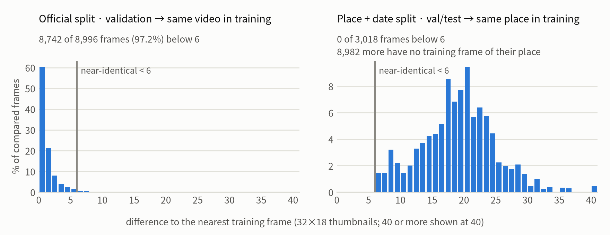
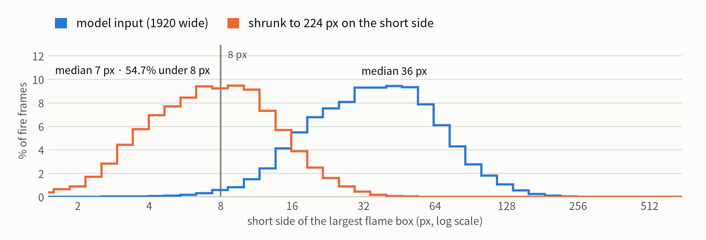
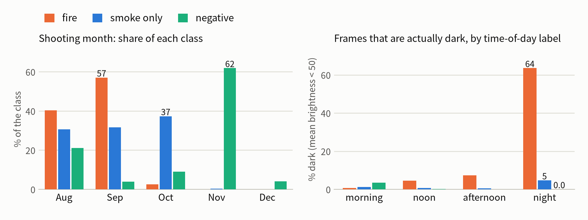
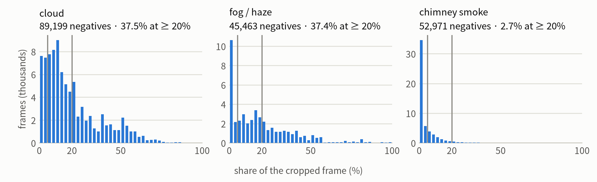
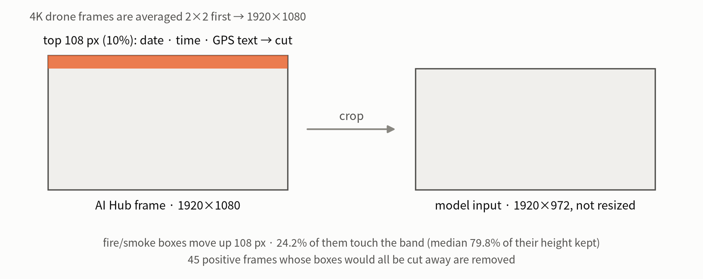
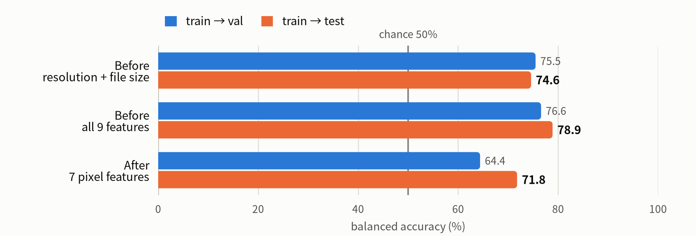
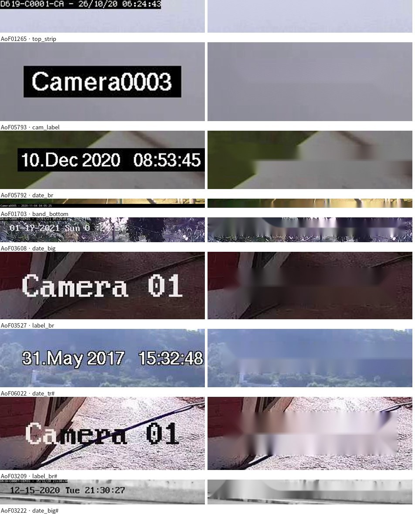

# Clouds, Fog and False Alarms in AI Wildfire Detection

English | [한국어](README.ko.md)

Binary wildfire detection on camera images: **does a frame show fire or smoke, or not?** The project asks whether distractors that look like smoke, such as clouds, fog/haze and chimney smoke, make a CNN raise false alarms, and how to reduce them.
This repository holds the data stage in three parts: **data collection and processing**, **data overview and visualization**, and **data preprocessing**. It covers AI Hub's wildfire dataset (71330) and two outside datasets (D-Fire, DeepFire) prepared as test sets from other sources. Modeling is the next stage.

- **Hypothesis**: the more of the frame clouds and fog/haze cover, the more false alarms.
- **Targets**: F1 ≥ 0.85, half the baseline's false-alarm rate on negatives with ≥ 20% cloud + fog, and at most 1 percentage point lost in recall.
- **Background**: in 2025, about 138,000 of roughly 200,000 alerts (about 70%) from Korea's AI wildfire-camera platform were errors, with glare, lens dirt, fog, clouds and swaying trees named as causes (Korea Forest Service figures, reported in September 2026).

## Results of the data stage

| | |
| --- | --- |
| AI Hub frames used | **422,285** of 630,000 labeled frames: train 257,183 · val 75,118 · test 89,984 |
| Classes | positive (fire or smoke) 266,338 = fire 86,702 + smoke only 179,636 · negative 155,947 |
| Split | by **place + shooting date** (82 blocks, 60 : 20 : 20). The official split leaks: 97.2% of its validation frames have a near-identical training frame. In the new split, none of 12,000 checked val/test frames does |
| Model input | **1920×972**: 4K frames averaged 2×2 to 1920×1080, then the top 108 px (on-screen date, time and GPS text) cut off. Not resized: the largest flame box is 36 px on its short side (median), 7 px if the frame were shrunk to 224 px |
| Shortcut check | a depth-2 decision tree on simple image statistics: 78.9% balanced accuracy on test before preprocessing, 71.8% after (chance 50%) |
| Other-source test sets | D-Fire 21,498 (11,689 positive · 9,809 negative) and DeepFire 1,896 (948 · 948), on-screen text inpainted, fitted into 1920×972 |
| Processing errors | 0 of 422,285 AI Hub frames and 0 of 23,423 outside images |

## Pipeline



## 1. Data collection and processing

Each step is a section of [`notebooks/preprocess.ipynb`](notebooks/preprocess.ipynb) (AI Hub) or [`notebooks/external.ipynb`](notebooks/external.ipynb) (D-Fire, DeepFire), with its code and output; the label, split and leakage checks are scripts in the repository root.

### 1.1 Sources and roles

| Dataset | What it holds | Role |
| --- | --- | --- |
| AI Hub 71330 (지역안전재난(산불) 방재의 고도화를 위한 대규모 인공지능 데이터베이스) | 630,000 labeled frames (official train 560,365 · val 69,635), mostly 1920×1080 with some 3840×2160. Real positives: staged small fires and smoke canisters at 16 sites in Gangneung. Negatives: landscapes at 54 sites across Korea, with boxes for clouds, fog/haze and chimney smoke. Also 126,107 synthetic positives | training, validation and test |
| [D-Fire](https://github.com/gaiasd/DFireDataset) (CC0) | 21,527 images with smoke and fire boxes: surveillance cameras (AoF), web images, public datasets | test from another source |
| DeepFire (Mendeley Data, CC BY 4.0) | 1,900 forest images, 250×250, fire / no fire | test from another source |
| SmokeFire (Hugging Face) | 7,575 images, checked first and **not used**: its smoke class comes from a few CCTV scenes, resolution alone predicts the class (86.8% on its test split), and 54% of its validation and test images are near-duplicates of training images | — |

Training uses AI Hub only, so a model cannot separate classes by which dataset an image came from; D-Fire and DeepFire show whether it still works on images from elsewhere.

### 1.2 Reading the archives

AI Hub ships the training images as a split ZIP64 (`TS.z01`–`TS.z05` + `TS.zip`, 588 GB) that Python's `zipfile` cannot open, and merging it would need another 588 GB. [`aihub_split_zip.py`](aihub_split_zip.py) reads the central directory of the last volume and maps each member to its volume and offset, so any frame is read straight from the parts. Frames are decoded from the archive every time; no processed copy is written.

### 1.3 Label conversion: objects → one label per frame

AI Hub labels objects, not frames (box classes: flame, black smoke, white/gray smoke, cloud, fog/haze, chimney smoke). The frame label follows from the database and the boxes, by rule ([`analyze_aihub_labels.py`](analyze_aihub_labels.py), [`summarize_aihub_labels.py`](summarize_aihub_labels.py)):

| Result | Rule | Frames |
| --- | --- | ---: |
| **positive** | `PositiveRealDB` with at least one flame or smoke box (sub-class *fire* if it has flame, else *smoke*) | 266,383 |
| **negative** | `NegativeDB` without flame or smoke boxes (only cloud, fog/haze, chimney-smoke boxes) | 156,260 |
| kept aside: smoke in negatives | `NegativeDB` with a white/gray smoke box: factory smoke, but also smoke that looks real around forests and villages, so neither class | 23,729 |
| excluded: synthetic positives | `PositiveSyntheticDB`: fire and smoke pasted into CCTV and drone frames | 126,107 |
| excluded: unused positive sites | 12 of the 16 real-positive sites; only the 4 largest are used (82.2% of the real positive frames) | 57,521 |

### 1.4 Exclusion filters

| Step | Removed | Left |
| --- | ---: | ---: |
| all label JSON | | 630,000 |
| synthetic positives | −126,107 | 503,893 |
| 12 unused positive sites | −57,521 | 446,372 |
| smoke inside negatives → kept aside as *uncertain* | −23,729 | 422,643 |
| unsupported resolutions (1280×720, 960×540, 4032×1816) | −290 | 422,353 |
| positives whose every fire/smoke box lies in the top band that is cut off | −45 | 422,308 |
| one CCTV (Pyeongchang) whose time stamp sits below the cut line | −23 | **422,285** |

### 1.5 Splitting by place and shooting date

The official split puts neighbouring frames of the same video on both sides (section 2.1). Frames are therefore grouped into **blocks of one place and one shooting date**, merged when a camera spans two days or when two dates of one place share near-identical frames ([`aihub_group_links.py`](aihub_group_links.py): the same video re-entered under another date), which gives 82 blocks. Blocks are assigned to train / val / test at 60 : 20 : 20.

- `split_v1` ([`make_aihub_split.py`](make_aihub_split.py)) balanced class, day/night, weather and Gangneung vs elsewhere, but not the device or the distractors: 63% of the test negatives were drone frames (10% in training), so a test false-alarm rate would have mixed fog with an unfamiliar viewpoint.
- `split_v2` ([`make_aihub_split_v2.py`](make_aihub_split_v2.py)) keeps the 13 positive blocks and reassigns the 69 negative-only blocks (32 moved), also balancing drones, cloud and fog **area** (≥ 5%, ≥ 20%), chimney smoke and August–September frames. Starting from v1 and 240 random assignments, it moves and swaps blocks until the cost stops falling. Two earlier versions were dropped: moving as few blocks as possible fixed drones but halved the cloudy test negatives (24% → 13%), and counting fog as "has a box" filled the test share with one large block barely touched by fog (median area 0.3%), pushing every real fog scene into validation.

| Stratum (negatives) | train / val / test, v1 | train / val / test, v2 |
| --- | --- | --- |
| drone | 29.7 / 6.6 / 63.8% | 59.6 / 20.1 / 20.3% |
| fog/haze area ≥ 20% | 86.3 / 0.0 / 13.7% | 61.6 / 17.6 / 20.7% |
| cloud area ≥ 20% | 35.8 / 28.1 / 36.2% | 58.3 / 20.0 / 21.7% |

The largest gap from 20% in any val or test stratum fell from 43.8 to 4.7 percentage points, and [`check_aihub_split.py`](check_aihub_split.py) finds no val or test frame near-identical to a training frame of the same place.

| | train | val | test | all |
| --- | ---: | ---: | ---: | ---: |
| positive · fire | 49,406 | 8,560 | 28,736 | 86,702 |
| positive · smoke only | 110,195 | 37,550 | 31,891 | 179,636 |
| negative | 97,582 | 29,008 | 29,357 | 155,947 |
| **all** | **257,183** | **75,118** | **89,984** | **422,285** |

Positives come from 2 sites in training, 4 in validation and 3 in test, so most test fire frames come from sites the model never saw.

### 1.6 Label tidy-up

Boxes are moved into the coordinates of the processed frame (`x' = x·1920/W`, `y' = y·1920/W − 108`), distractor area is measured again on the cropped frame, and the condition columns (weather, time of day, device, distance) are normalized; capture dates come in mixed formats and are rewritten as `YYYYMMDD`.

### 1.7 D-Fire and DeepFire

- **D-Fire**: 21,527 images (surveillance cameras 8,384, web 11,807, public datasets 1,336). Its YOLO boxes (0 = smoke, 1 = fire) become the same frame labels as AI Hub's; 18 zero-size boxes are left out of the box statistics.
- **DeepFire**: 1,900 images in fire / no-fire folders; 4 exact duplicates are dropped. 76.6% of its images are the same photos as SmokeFire's or a Kaggle set's, so it is not independent of SmokeFire; it serves only as a test set.
- **Label check**: near-identical images are grouped (10,661 groups in D-Fire), so results can be counted per scene; 7 negatives that visibly show fire or smoke are removed, and 22 ambiguous hazy skies are kept apart.

## 2. Data overview and visualization

[`notebooks/eda.ipynb`](notebooks/eda.ipynb) goes through every label and frame of the experiment in 13 sections: integrity of the labels and capture metadata, class composition per split, resolution and file size, capture conditions (weather, time of day, device, distance), places and dates, box size and position, distractors, pixel statistics (one frame in ten per video), shortcut checks and leakage. Its charts and tables stay in the notebook; only the AI Hub photos are removed. The four figures below are drawn from the final 422,285 frames ([`figures/make_figure_data.py`](figures/make_figure_data.py) writes the counts behind them to [`figures/data/`](figures/data/)) and show the findings that shaped the split and the preprocessing.

### 2.1 The official split leaks

<picture>
  <source media="(prefers-color-scheme: dark)" srcset="figures/leak_en_dark.png">
  
</picture>

Each validation frame is compared with its nearest training frame on 32×18 thumbnails. In the official split, 8,742 of 8,996 validation frames (97.2%) are near-identical (difference below 6) to a training frame of the same video. In the place + date split, 3,018 of 12,000 checked val/test frames have a training frame of the same place at all, and none is that close. → split by place + shooting date (section 1.5).

### 2.2 Flames are tiny

<picture>
  <source media="(prefers-color-scheme: dark)" srcset="figures/flame_en_dark.png">
  
</picture>

At the model input, the largest flame box of a fire frame is 36 px on its short side (median; 1.0% are under 8 px). Shrinking the frame to 224 px on its short side, the usual ImageNet input, leaves 7 px, and 54.7% of the fire frames end up with a flame under 8 px. → keep the whole 1920×972 frame (section 3.1).

### 2.3 Season and night follow the class

<picture>
  <source media="(prefers-color-scheme: dark)" srcset="figures/time_en_dark.png">
  
</picture>

The staged fires were shot in August and September (97% of the fire frames), the negatives mostly in October to December (75%), so colour and light change with the class. Frames labelled "night" are dark for fire (64%) but almost never for negatives (0.04%): there are no night negatives, and 92.5% of the dark frames are positives. → dark frames and August–September negatives get their own test groups, and the shortcut check (section 3.2) measures how much of this a simple rule can still use.

### 2.4 Distractors in the negatives

<picture>
  <source media="(prefers-color-scheme: dark)" srcset="figures/distractors_en_dark.png">
  
</picture>

The negatives come with boxes for clouds, fog/haze and chimney smoke, which makes the hypothesis measurable. Clouds cover at least 20% of the cropped frame in 37.5% of the 89,199 negatives that have them, fog/haze in 37.4% of 45,463, chimney smoke in 2.7% of 52,971. The lines at 5% and 20% are the area groups of the test set (section 3.3).

### 2.5 Findings and decisions

| Finding | Decision |
| --- | --- |
| Official split: 97.2% of validation frames near-identical to a training frame of the same video | split by place + shooting date (split_v2) |
| "Night" negatives are not dark (0.04%), and 92.5% of dark frames are positives | no synthetic night negatives; results reported separately for dark frames (`dark` column) |
| Flames are tiny: 36 px at the model input, 7 px at 224 px (54.7% under 8 px) | keep the whole frame, 1920×972 |
| 4K frames are spread unevenly (19% of test negatives, 6% of test fire) | average 4K frames 2×2 to 1920×1080, so resolution cannot give the class away |
| Season follows the class: 97% of fire and 62% of smoke frames from August–September, 75% of negatives from October–December | report the August–September negatives separately; consider hue augmentation in modeling |
| Smoke boxes inside negatives (23,729 frames) | keep them aside as *uncertain* |
| One GPS value of a single site copied into 45 addresses (122,343 frames) | do not use GPS or altitude |

## 3. Data preprocessing

### 3.1 AI Hub frames: one function for training, validation and test

<picture>
  <source media="(prefers-color-scheme: dark)" srcset="figures/frame_en_dark.png">
  
</picture>

```python
# wildfire_data.py (excerpt, comments translated)
BASE_W, BASE_H = 1920, 1080
CROP_TOP = 108                              # top 10%: date, time and GPS text of every camera but one
OUT_W, OUT_H = BASE_W, BASE_H - CROP_TOP    # 1920×972

def preprocess(jpeg_bytes):
    im = Image.open(io.BytesIO(jpeg_bytes)).convert('RGB')
    if im.size == (2 * BASE_W, 2 * BASE_H):
        im = im.reduce(2)                   # 2×2 pixel mean, exactly half
    elif im.size != (BASE_W, BASE_H):
        raise ValueError(f'unsupported resolution {im.size}')
    return im.crop((0, CROP_TOP, OUT_W, BASE_H))
```

- **Why cut the top band:** drone frames carry a date and GPS line at the top left (64.6% of positive drone frames, 34.3% of negative ones), and CCTV frames a time stamp. 392 cameras were checked one frame each; every overlay but one camera's lies inside the top 108 px.
- **Cost:** reading a 1080p frame from the archive takes 5.6 ms and processing 15.9 ms (4K: 16.6 + 60.9 ms); all 422,285 frames took 3.6 CPU-hours, with no error.
- **Normalization:** training-set mean (0.384, 0.385, 0.345) and std (0.256, 0.252, 0.265), next to ImageNet's, in [`prep/norm_stats.json`](prep/norm_stats.json).

### 3.2 Shortcut check before and after

A model can score well by reading resolution, file size or brightness instead of fire and smoke. A depth-2 decision tree, fit on training frames and scored on val and test, measures how far such statistics alone go:

<picture>
  <source media="(prefers-color-scheme: dark)" srcset="figures/shortcut_en_dark.png">
  
</picture>

Preprocessing removes resolution and file size as cues. What is left (71.8% on test) comes from darkness, sharpness and the share of fire-coloured pixels ([`prep/tables/shortcut_rule.txt`](prep/tables/shortcut_rule.txt)), which follow the night and season gaps of section 2.3; this is the baseline a trained model has to beat for the right reasons. Blurring the 4K-origin frames to match the sharpness of the 1080p ones did not change it (72.0 → 72.2%), so it was left out.

### 3.3 Test groups for the hypothesis

[`prep/test_groups.csv`](prep/test_groups.csv) defines the test subsets as pandas queries on the manifest, so false-alarm rates can be read by distractor type, area and place:

| Test negatives | Frames | Sites |
| --- | ---: | ---: |
| all | 29,357 | 19 |
| cloud only | 11,585 | 17 |
| fog/haze only | 4,708 | 6 |
| chimney smoke only | 9,058 | 3 |
| cloud + fog area < 5% / 5–20% / ≥ 20% | 11,355 / 7,663 / 10,339 | 13 / 16 / 15 |
| fog/haze area ≥ 20% | 3,524 | 6 |
| drone | 6,633 | 5 |
| August–September (same season as the positives) | 7,407 | 7 |

### 3.4 D-Fire and DeepFire: on-screen text and size

[`external_data.py`](external_data.py) gives the outside images the same input as AI Hub's:

1. **On-screen text:** most of D-Fire's 8,384 surveillance-camera frames carry dates, times and camera names. `find_overlays()` finds text lines (top strip, camera label, bottom-right date, bottom band, large dates; it also retries on the mirrored frame). Every frame the detector could have missed was then checked by eye, and 65 boxes in 63 frames were added by hand. The boxes are filled from their surroundings (dilated by 3 px, OpenCV Telea inpainting); a flat gray box would itself look like smoke or fog. 8,201 frames (97.8%) were masked.
2. **Size:** fitted into 1920×972 with the aspect ratio kept and the margin filled with the ImageNet mean colour, which is zero after normalization. The top is not cut: that was for AI Hub's text band, and here it would only cut rising smoke.



Result: D-Fire 21,498 images (11,689 positive, 9,809 negative; 896 dark negatives, 2,499 dark positives) and DeepFire 1,896 (948 each), all 1920×972, with their own test groups ([`prep/external_test_groups.csv`](prep/external_test_groups.csv)): night negatives, sunsets, city lights, lightning, factory smoke.

## 4. Next: modeling

The training-time handling is drafted in [`modeling/`](modeling/) and not run yet: a sampler that draws at most N frames per video and class each epoch (a video holds a median of 23–72 frames, and up to 1,012), class weights from the drawn counts, and flips and small shifts as augmentation, all on top of `preprocess()`. Planned experiments: E1 baselines (a small CNN, ResNet-18/50, EfficientNet-B0 / MobileNetV3) at 1920×972, E2 tuning, E3 reducing false alarms on the distractor groups, scored against the targets above and the 71.8% shortcut baseline.

## Repository layout

```text
Wildfire-detection/
├── aihub_split_zip.py            # ① reads AI Hub's split ZIP64 (TS.z01–z05 + TS.zip) without merging
├── analyze_aihub_labels.py       # ① every label JSON → one row per frame
├── summarize_aihub_labels.py     # ① class conversion and the biases by source and condition
├── aihub_group_links.py          # ① near-identical frames across dates of one place → merged blocks
├── make_aihub_split.py           # ① split_v1 by place + shooting date
├── make_aihub_split_v2.py        # ① split_v2: negative blocks reassigned (drone, cloud, fog, chimney, season)
├── check_aihub_split.py          # ① leakage of the new splits
├── analyze_smokefire.py, analyze_deepfire.py   # ① checks of the candidate datasets
├── check_aihub_leak.py           # ② leakage of the official split
├── analyze_aihub_images.py       # ② brightness, contrast, saturation, sharpness, text score, thumbnails per frame
├── summarize_aihub_images.py     # ② night negatives, text overlays, shallow-tree shortcuts, near-duplicates
├── check_night_normal.py, check_fire_lookalike.py, tag_lookalike_clip.py   # ② dark negatives, fire look-alikes (SigLIP tags)
├── aihub_look_val.py, aihub_sample_sheets.py   # ② photo grids for local review (their images are not in Git)
├── wildfire_data.py              # ③ AI Hub: preprocess(), box coordinates, archive reader for training
├── external_data.py              # ③ D-Fire / DeepFire: find_overlays(), manual overlays, inpainting, fit into 1920×972
├── notebooks/
│   ├── preprocess.ipynb          #   ①③ AI Hub processing and preprocessing (outputs kept, AI Hub photos removed)
│   ├── eda.ipynb                 #   ②  AI Hub overview and visualization (outputs kept, AI Hub photos removed)
│   ├── external.ipynb            #   ①③ D-Fire / DeepFire processing and preprocessing (with their images)
│   ├── eda_lib.py, prep_lib.py, external_lib.py   # heavy computations, cached under notebooks/cache/
│   └── build_eda.py, build_preprocess.py, build_external.py, eda_obs.json, export_eda.py   # build and run the notebooks
├── prep/                         # outputs of the notebooks: tables/, norm_stats.json, test groups, D-Fire / DeepFire lists
├── report/                       # summaries and logs of the label, leakage and split checks
├── figures/                      # README figures: make_figure_data.py → data/ (counts only) → make_figures.py
└── modeling/                     # training-time handling (draft)
```

① data collection and processing · ② data overview and visualization · ③ data preprocessing

## How to run

Tested with Python 3.13 on an NVIDIA DGX Spark (aarch64). The scripts find their folders (`data/`, `prep/`, `report/`, `notebooks/cache/`) next to themselves, so the repository folder is the project folder. AI Hub 71330 is read from `/data/aihub/71330/` (`AIHUB` in `wildfire_data.py` and `notebooks/eda_lib.py`, `BASE` in the check scripts).

```bash
python3 -m venv .venv_eda && .venv_eda/bin/pip install -r requirements.txt
.venv_eda/bin/python -m ipykernel install --user --name eda      # the notebooks use the kernel "eda"
```

1. Download AI Hub 71330 (label `TL.zip` / `VL.zip`, images `TS.z01`–`TS.zip` / `VS.zip`) after approval on [AI Hub](https://aihub.or.kr), and D-Fire and DeepFire into `data/DFire` and `data/DeepFire`.
2. Labels and checks: `analyze_aihub_labels.py` → `summarize_aihub_labels.py` → `analyze_aihub_images.py val|train` → `check_aihub_leak.py`.
3. Split: `aihub_group_links.py` → `make_aihub_split.py` → `make_aihub_split_v2.py` → `check_aihub_split.py 2000 v2`.
4. Notebooks: `cd notebooks && ../.venv_eda/bin/python build_preprocess.py` (and `build_eda.py`, `build_external.py`) rebuild and run them. The first full pass over the AI Hub frames takes about 33 minutes, later runs about 40 seconds from `notebooks/cache/`.
5. Figures: `python figures/make_figure_data.py && python figures/make_figures.py`.

## What is not included

- **AI Hub data:** images, labels, and anything that lists them frame by frame (the manifest, boxes, split files, per-frame measurements). AI Hub's terms do not allow redistribution, so the notebooks keep their tables and charts but not the AI Hub photos, `figures/data/` holds counts only, and running the steps above rebuilds the lists.
- **Project documents** (proposal, slides, reports): they contain AI Hub photos.
- D-Fire and DeepFire images themselves (download them from their sources). Their processed lists are included (`prep/external_manifest.csv.gz`, `prep/external_boxes.csv.gz`).

## References

- AI Hub, 지역안전재난(산불) 방재의 고도화를 위한 대규모 인공지능 데이터베이스 (dataset 71330).
- D-Fire: P. V. A. B. de Venâncio, A. C. Lisboa, A. V. Barbosa, "An automatic fire detection system based on deep convolutional neural networks for low-power, resource-constrained devices", *Neural Computing and Applications*, 2022. [github.com/gaiasd/DFireDataset](https://github.com/gaiasd/DFireDataset) (CC0).
- DeepFire: A. Khan, B. Hassan, Mendeley Data, 2020, [doi:10.17632/gjmr63rz2r.1](https://doi.org/10.17632/gjmr63rz2r.1) (CC BY 4.0).
- A. Telea, "An image inpainting technique based on the fast marching method", *Journal of Graphics Tools*, 2004 (OpenCV `INPAINT_TELEA`).
